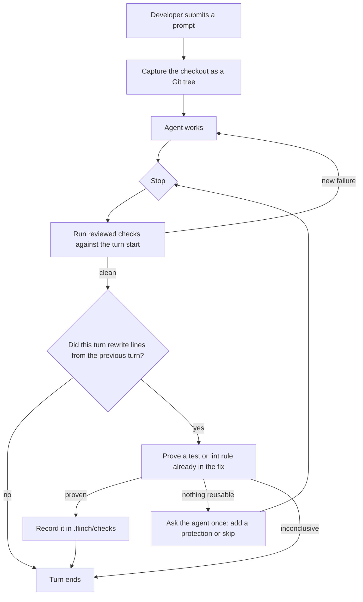

# How Flinch works

Flinch runs inside the host's turn hooks:
- it captures the checkout when a turn starts;
- it proves candidate checks against the broken and the fixed code;
- it runs the reviewed checks before the agent hands control back.

The goal follows the "never twice" practice that Lauren Tan describes for the GrokBot team: every correction should make the codebase harder to get wrong the same way again ([*All Code Is Slop (Except Mine)*](https://ai.engineer/talks/O_zcc6Xl12g-all-code-is-slop-except-mine)).

## One correction, end to end

Take the retry-delay example from the [README](../README.md). Underneath, it goes like this:

1. **Prompt.** The prompt hook writes the checkout to a Git tree through a temporary index. Nothing is staged or committed ([0004](adr/0004-run-proofs-in-ref-free-trees.md)).
2. **Nomination.** At Stop, the turn has rewritten lines the previous turn added, so it is nominated ([0006](adr/0006-nominate-deterministically-let-the-agent-decide.md)). The new test case becomes the candidate ([0005](adr/0005-let-the-corrected-agent-write-the-check.md)).
3. **Proof.** Two fresh trees get the broken `src/retry.ts` and the new test. Both runs fail at the same `expect` with the same diagnostic. On the fix, the case and its neighbor pass ([0003](adr/0003-prove-every-check-against-the-real-mistake.md)).
4. **Record.** `.flinch/checks/<id>.yml` lands next to the fix. Timings stay under the Git directory ([0011](adr/0011-keep-state-local-and-out-of-the-working-tree.md)).
5. **Repeat.** A later turn edits only `src/retry.ts`. The scope matches, and the case passed at the start of the turn and fails now, so the Stop hook returns the failure to the agent ([0008](adr/0008-compare-the-end-of-a-turn-with-its-starting-checkout.md), [0009](adr/0009-budget-each-hook-and-let-the-turn-finish-when-time-runs-out.md)).

## The loop

Every step has a deadline. When time runs out, or Flinch cannot tell whether a failure is new, the turn ends.

## Decisions

**Verification**
- [0001. Keep the engine deterministic](adr/0001-keep-the-engine-deterministic.md): the agent interprets the correction, and tool results decide the verdict.
- [0002. Put checks in the repository's own tools](adr/0002-put-checks-in-the-repositorys-own-tools.md): a check is an ordinary test or lint rule, so it runs in CI and in a clone without Flinch.
- [0003. Prove every check against the real mistake](adr/0003-prove-every-check-against-the-real-mistake.md): two broken runs fail at the same assertion, and the fix and a legitimate neighbor pass.
- [0004. Run proofs in ref-free trees](adr/0004-run-proofs-in-ref-free-trees.md): replays come from Git trees, with no commits, refs or changes to your staging.

**The turn loop**
- [0005. Let the corrected agent write the check](adr/0005-let-the-corrected-agent-write-the-check.md): Flinch reuses a test already in the fix before asking for one.
- [0006. Nominate deterministically, let the agent decide](adr/0006-nominate-deterministically-let-the-agent-decide.md): a turn is nominated when it rewrites lines the previous turn added.
- [0007. Choose the strongest rung](adr/0007-choose-the-strongest-rung.md): structure, lint, test and guard come first, and one line of guidance is the floor.

**Safety and budgets**
- [0008. Compare the end of a turn with its starting checkout](adr/0008-compare-the-end-of-a-turn-with-its-starting-checkout.md): only problems the turn introduced can block.
- [0009. Budget each hook and let the turn finish when time runs out](adr/0009-budget-each-hook-and-let-the-turn-finish-when-time-runs-out.md): one deadline per hook and a fixed continuation budget.
- [0010. Keep the reviewed check in the comparison](adr/0010-keep-the-reviewed-check-in-the-comparison.md): checks load from the trusted revision, so weakening one shows up.
- [0011. Keep state local and out of the working tree](adr/0011-keep-state-local-and-out-of-the-working-tree.md): the diff carries the contract, and everything else stays under the Git directory.
- [0014. Enforce locally proven checks from the turn snapshot](adr/0014-enforce-locally-proven-checks-from-the-turn-snapshot.md). The next turn can use a verified check present when the developer submitted the prompt.

**Hosts**
- [0012. Share the engine and adapt to each host's turn lifecycle](adr/0012-share-the-engine-and-adapt-to-each-hosts-turn-lifecycle.md): one engine, with thin adapters for Claude Code, Codex and Antigravity.
- [0013. Install once per user and act only in trusted workspaces](adr/0013-install-once-per-user-and-act-only-in-trusted-workspaces.md): one reviewed install, and hooks act only where the host or the developer trusts the clone.

## What Flinch doesn't do

- **No model in the verdict.** Tool results decide what counts, so every verdict can be rerun.
- **No Flinch runner required.** Checks are ordinary tests and lint rules, and they keep working if you remove Flinch.
- **No silent fallback to prose.** A test that can't be proven stays in the diff for review; it never becomes a line in `AGENTS.md`.
- **No service.** Flinch is a local CLI plus hook adapters: no account, no network calls of its own, and state under the Git directory.
- **Not a reviewer or a PR bot.** Flinch works inside the agent's turn, before review. Review stays with your team's process.
- **Not a test generator.** It records one protection per correction, not tests for coverage.
- **Not a permission system.** Policies for commands and paths belong to dedicated guards.

[Trust model and operating limits](limitations.md) covers what Flinch runs on your machine and with what access.
